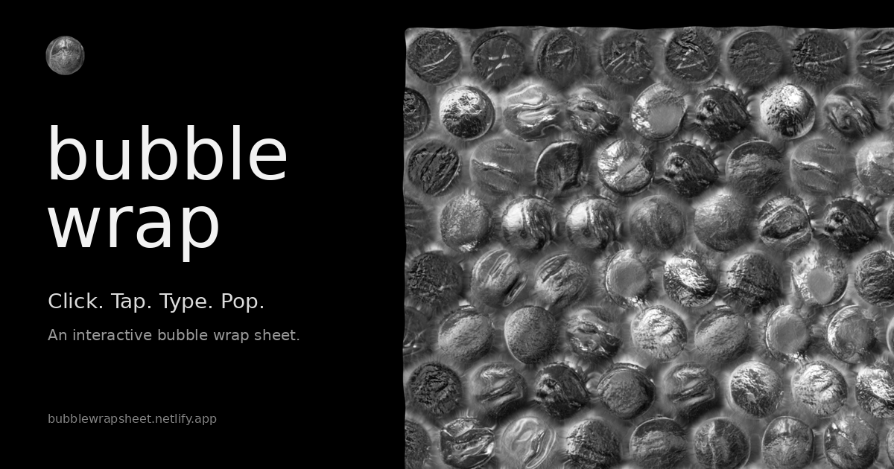

# Bubble Wrap

Click, drag, tap or use a physical keyboard to pop those bubbles. Works on desktop and mobile.

**Demo Link:** https://bubblewrapsheet.netlify.app/



## Hidden interactions

- Pull the invisible corner grab areas to flex the sheet.
- The 47 physical keys in the four QWERTY rows map spatially to the bubbles.
- Spacebar refreshes the sheet, even when it is already fresh.
- Enter on the focused sheet pops its next bubble.
- Append `?panel=show` to the URL to open the settings sidebar.

## Build and deploy

Requires Node.js 22 or newer.

```sh
npm install
npm run build   # outputs dist/
npm run dev     # http://127.0.0.1:5173
```

Netlify builds with `npm run build` and publishes `dist/` via `netlify.toml`. No environment variables or backend needed. Update `site.config.json` if you deploy to a different domain.

## Credits and assets

**Sound effects** by [Anthousai](https://freesound.org/people/Anthousai/) on [Freesound](https://freesound.org/) under [CC0](https://creativecommons.org/publicdomain/zero/1.0/).

**Libraries** used by the sheet and Survival Run. License texts are in `licenses/`.

- [Bootstrap 5.3](https://getbootstrap.com/) by The Bootstrap Authors, MIT. The page shell.
- [`glsl-blend`](https://github.com/jamieowen/glsl-blend) by Jamie Owen, MIT. Selected blend functions in the bubble shader.
- [Smoothie Charts 1.36](https://github.com/joewalnes/smoothie) by Joe Walnes and Drew Noakes, MIT. The pop-velocity trace.
- [Tweakpane 4.0.5](https://tweakpane.github.io/docs/) by cocopon, MIT. The level-design tuning panel.
- [number-flow 0.6](https://number-flow.barvian.me/) by Maxwell Barvian, MIT. Animated score, timer, and goal digits.
- [Material Symbols](https://fonts.google.com/icons) by Google, Apache 2.0, bundled from the [`material-symbols`](https://github.com/marella/material-symbols) package. Game and sheet icons.
- [TypeScript](https://www.typescriptlang.org/) by Microsoft, Apache 2.0. The app is written in it.
- [Ajv](https://ajv.js.org/) by Evgeny Poberezkin, MIT. Checks `config/level-design.json` while building.
- [esbuild](https://esbuild.evanw.com/) by Evan Wallace, MIT. Bundles the app for the browser.
